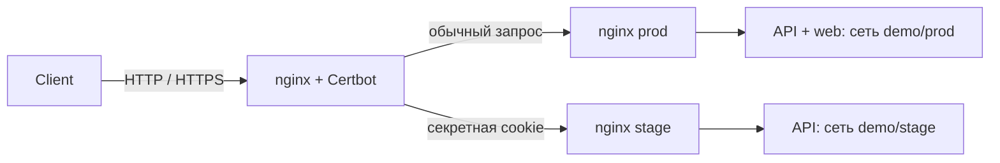

# Composer example

GitOps-пример: внешний nginx принимает HTTP/HTTPS, выбирает prod или stage по cookie
и передаёт запрос отдельному nginx окружения. API работает в обоих окружениях,
web — только в prod. Все образы закреплены digest.

```text
apps/
  demo/
    api/                 # vars/base.yaml, stage.yaml, configs/message.txt.tmpl
    web/                 # vars/base.yaml, configs/message.txt.tmpl
    nginx/               # vars/base.yaml, stage.yaml, configs/nginx.conf.tmpl
  edge/
    gateway/             # nginx + Certbot в готовом образе
      vars/base.yaml     # настройки TLS и зашифрованный secrets.stage_token
      configs/
templates/compose.yaml.tmpl
scripts/configure.py
.sops.yaml               # только публичный age recipient
host.yaml.example        # скопировать за пределы GitOps-репозитория
test/                    # приёмка в одноразовой Linux VM
```

Один каталог приложения — один Compose project. Prod использует base,
stage — base + stage. Отсутствие stage.yaml выключает приложение в stage.
Основные изменения вносятся в base.yaml; stage.yaml содержит только отличия stage.
`edge` здесь обычный namespace, Composer ничего не знает о назначении сервисов.

## Локальный запуск

Нужны Docker Engine или Docker Desktop, собранный `../composer/bin/composer`,
Git, Python 3.11+, SOPS и age. Команды выполняются из этого репозитория.

При первом использовании создайте свой ключ вне GitOps и новый секрет cookie:

```sh
python3 -m venv .venv
.venv/bin/pip install -r scripts/requirements.txt
.venv/bin/python scripts/configure.py ../composer-example.agekey
cp host.yaml.example ../composer.local.yaml
```

Если host YAML уже настроен, сохраните его и добавьте `age_key_file` с путём
к ключу. Пути в host YAML разрешаются относительно самого host YAML.
`configure.py` заменяет демонстрационный блок `secrets` и шифрует его для вашего
ключа; это первоначальная настройка, для обычных правок используйте SOPS.

Composer читает только committed branch. Для нового репозитория:

```sh
git init -b master
git add .
git commit -m 'Configure Composer example'
git branch dev
```

После подготовки Git и credentials вся инфраструктура поднимается одной командой:

```sh
../composer/bin/composer apply --config ../composer.local.yaml --wait --timeout 15m
```

Сети, volumes и начальный сертификат создаются автоматически. Для постоянного
наблюдения за commits запустите `composer run --config ../composer.local.yaml`.
На Ubuntu агент устанавливается через [composer install](../composer/docs/systemd.md).
В примере `source.branches.prod: master`, `source.branches.stage: dev`.
Имена веток произвольные, включая `main`. Для общей ветки укажите одинаковое
значение у нужных окружений в `source.branches`.

HTTP слушает `127.0.0.1:18080`, HTTPS — `127.0.0.1:18443`.
Локальный сертификат выпускается встроенным локальным CA образа (`USE_LOCAL_CA=1`):

```sh
curl -ki https://localhost:18443/api/
```

Ответ содержит `X-Composer-Environment: prod`. Cookie `composer_stage` со значением
`<secrets.stage_token>:stage` выбирает общий stage; `<secrets.stage_token>:dan` — персональный. Значение можно посмотреть через SOPS:

```sh
export SOPS_AGE_KEY_FILE="$PWD/../composer-example.agekey"
sops decrypt --extract '["secrets"]["stage_token"]' apps/edge/gateway/vars/base.yaml
```

Передайте его в cookie браузера или `curl --cookie 'composer_stage=…:stage'`.
Неверная или отсутствующая cookie выбирает prod. `/api/` доступен в обоих
окружениях; `/` в stage возвращает ошибку, поскольку stage web отсутствует.
Для проверки stage используйте отдельный профиль браузера: один origin означает
общие cookies и browser storage. Cookie маршрутизации не заменяет авторизацию приложения.

## Сети и обновления



Nginx и приложения каждого окружения подключены только к своей namespace-сети.
Внешний nginx явно подключён к сетям demo/prod и demo/stage через `namespace_networks`
общего шаблона. Helper `network "stage" "demo"` возвращает имя сети текущей
installation; сеть должна принадлежать включённому приложению или существовать
заранее. Оба nginx включены, поэтому Composer создаёт обе сети до запуска workers.

У внутренних nginx и приложений нет host ports и container_name. Масштабирование
задаётся через `compose.services.<name>.deploy.replicas`. Nginx обновляет адреса
backend через Docker DNS. Публичные порты закреплены только за внешним nginx.
При недоступном stage возвращается ошибка без перехода в prod.

Composer читает весь GitOps-снимок отдельно для каждого окружения: Dockerfile,
configs, vars и общий Compose template. Изменения в `dev` не затрагивают prod.
Основные настройки по-прежнему пишутся в `base.yaml`; `stage.yaml` включает
приложение в stage и содержит только отличия окружения.

```sh
git switch dev
# Изменить base.yaml, Dockerfile.tmpl или configs, затем commit.
git add apps templates
git commit -m 'Update app'
# Проверить stage через cookie, затем перенести проверенные изменения:
git switch master
git merge dev
```

Для remote source нужен push соответствующей ветки. Локальный source видит commit
без push. Откат — `git revert` в ветке соответствующего окружения. Config-only
commit пересоздаёт затронутый project даже при прежнем image. При одинаковых
исходниках и отрендеренном Dockerfile prod переиспользует собранный в stage образ.
Для этого `build.commit` меняется в `base.yaml` ветки dev, а отдельный override
commit в stage.yaml не требуется.

Общий внешний gateway существует только в prod и читается из master. Для проверки
маршрутов приложений меняйте внутренний nginx в dev; конфигурация общего внешнего
входа применяется после merge в master.

## Публичный TLS

TLS завершается во внешнем nginx. Используется закреплённый по digest образ
[`jonasal/nginx-certbot`](https://github.com/JonasAlfredsson/docker-nginx-certbot):
первичный выпуск, расписание продления и reload nginx реализованы внутри него.
Собственных скриптов обслуживания TLS в репозитории нет.

В SOPS editor (`sops apps/edge/gateway/vars/base.yaml`) задайте:

- `tls.domain`: реальный домен; `tls.https_port: 443`.
- `compose.services.nginx.environment.CERTBOT_EMAIL`: ваш email.
- `compose.services.nginx.environment.USE_LOCAL_CA: "0"`.
- `compose.services.nginx.ports`: `["80:80", "443:443"]`.

DNS домена должен указывать на сервер, входящий порт 80 нужен для HTTP-01.
Nginx использует `/etc/letsencrypt/live/site/fullchain.pem` и `privkey.pem`.
Образ сначала обслуживает challenge по HTTP, а после выпуска включает HTTPS.
Certbot проверяет необходимость продления каждые 12 часов; nginx получает reload
без перезапуска контейнера. `/etc/letsencrypt` хранится в постоянном volume.
Docker socket не монтируется; Composer ничего не знает об управлении TLS.

Для переключения с локального CA на публичный ACME используйте новый пустой
volume `/etc/letsencrypt`: эти режимы не должны использовать одни сертификаты.
Локальный CA хранится в отдельном volume `/etc/local_ca` и нужен только разработке.
SOPS проверяет MAC всего файла, поэтому открытые поля зашифрованного base.yaml
также следует редактировать через SOPS. Изменения публикуются обычным commit.

## Проверки

[Инструкция приёмки](test/README.md) описывает cold-start, config-only rollout,
scale, revert, изоляцию окружений и настоящий HTTP-01 через локальный Pebble CA.
Публичный сертификат Let's Encrypt в этой проверке не выпускается.
[Полная приёмка](test/full/README.md) дополняет пример source builds, PostgreSQL,
secrets, Git polling и перезагрузкой Ubuntu; тот же сценарий запускается на macOS.

## Персональные окружения

Добавьте одну запись в host YAML:

```yaml
source:
  branches:
    prod: master
    stage: dev
    dan: users/dan
```

`composer run` подхватит изменение на следующем проходе. Ветка `users/dan` должна
существовать в GitOps-репозитории. Её `stage.yaml` включает нужные приложения;
каждый namespace получает отдельную сеть, Compose volumes изолированы по окружению.
Данные из prod автоматически не копируются.

Шаблоны получают `.Environments`, создают подключения общего nginx ко всем
окружениям и aliases `nginx-<окружение>`. Cookie `composer_stage=<секрет>:dan`
выбирает персональный nginx. Неизвестное окружение с правильным секретом или
недоступный backend возвращает 503, без fallback в prod. Неправильный секрет
оставляет запрос в prod. Общий nginx/Certbot обслуживает тот же домен и сертификат.

Добавление/удаление окружения может пересоздать общий nginx для изменения сетей;
контейнеры приложений prod и остальных stage остаются прежними. Удалите запись
`dan`, чтобы убрать его контейнеры. Volumes/images сохраняются; ошибка fetch
или удалённая ветка сама по себе контейнеры не удаляет.
