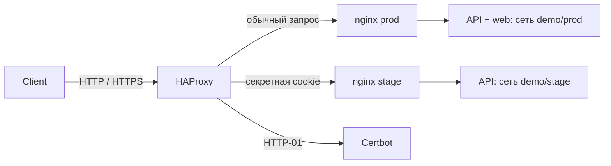

# Composer example

GitOps-пример: HAProxy принимает HTTP/HTTPS, выбирает prod или stage по cookie
и передаёт запрос отдельному nginx окружения. API работает в обоих окружениях,
web — только в prod. Все образы закреплены digest.

```text
apps/
  demo/
    api/                 # vars/base.yaml, stage.yaml, configs/message.txt.tmpl
    web/                 # vars/base.yaml, configs/message.txt.tmpl
    nginx/               # vars/base.yaml, stage.yaml, configs/nginx.conf.tmpl
  edge/
    gateway/             # HAProxy, Certbot и начальный сертификат
      vars/base.yaml     # настройки TLS и зашифрованный secrets.stage_token
      configs/
templates/compose.yaml.tmpl
scripts/configure.py
.sops.yaml               # только публичный age recipient
host.yaml.example        # скопировать за пределы GitOps-репозитория
test/                    # приёмка в одноразовой Linux VM
```

Один каталог приложения — один Compose project. Prod использует base + prod,
stage — base + stage. Отсутствие stage.yaml выключает приложение в stage.
Основные изменения вносятся в base.yaml; prod.yaml оставлен для редких отличий.
`edge` здесь обычный namespace, Composer ничего не знает о назначении сервисов.

## Локальный запуск

Нужны Docker Engine или Docker Desktop, собранный `../composer/bin/composer`,
Git, Python 3.11+, SOPS и age. Команды выполняются из этого репозитория.

При первом использовании создайте свой ключ вне GitOps и новый секрет cookie:

```sh
python3 -m venv .venv
.venv/bin/pip install -r scripts/requirements.txt
.venv/bin/python scripts/configure.py ../composer-example.agekey
cp host.yaml.example ../composer.local.yaml
```

Если host YAML уже настроен, сохраните его и добавьте `age_key_file` с путём
к ключу. Пути в host YAML разрешаются относительно самого host YAML.
`configure.py` заменяет демонстрационный блок `secrets` и шифрует его для вашего
ключа; это первоначальная настройка, для обычных правок используйте SOPS.

Composer читает только committed branch. Для нового репозитория:

```sh
git init -b master
git add .
git commit -m 'Configure Composer example'
```

После подготовки Git и credentials вся инфраструктура поднимается одной командой:

```sh
../composer/bin/composer apply --config ../composer.local.yaml --wait --timeout 15m
```

Сети, volumes и начальный сертификат создаются автоматически. Для постоянного
наблюдения за commits запустите `composer run --config ../composer.local.yaml`.
На Ubuntu агент устанавливается через [composer install](../composer/docs/systemd.md).
В примере ветка `master`; `source.branch` можно заменить на `main` или другую.

HTTP слушает `127.0.0.1:18080`, HTTPS — `127.0.0.1:18443`.
Локальный сертификат самоподписанный, действителен 30 дней:

```sh
curl -ki https://localhost:18443/api/
```

Ответ содержит `X-Composer-Environment: prod`. Cookie `composer_stage` со значением
`secrets.stage_token` выбирает stage. Значение можно посмотреть через SOPS:

```sh
export SOPS_AGE_KEY_FILE="$PWD/../composer-example.agekey"
sops decrypt --extract '["secrets"]["stage_token"]' apps/edge/gateway/vars/base.yaml
```

Передайте его в cookie браузера или `curl --cookie 'composer_stage=…'`.
Неверная или отсутствующая cookie выбирает prod. `/api/` доступен в обоих
окружениях; `/` в stage возвращает ошибку, поскольку stage web отсутствует.
Для проверки stage используйте отдельный профиль браузера: один origin означает
общие cookies и browser storage. Cookie маршрутизации не заменяет авторизацию приложения.

## Сети и обновления



Nginx и приложения каждого окружения подключены только к своей namespace-сети.
HAProxy явно подключён к сетям demo/prod и demo/stage через `namespace_networks`
общего шаблона. Helper `network "stage" "demo"` возвращает имя сети текущей
installation; сеть должна принадлежать включённому приложению или существовать
заранее. Оба nginx включены, поэтому Composer создаёт обе сети до запуска workers.

У nginx и приложений нет host ports и container_name. Масштабирование задаётся
через `compose.services.<name>.deploy.replicas`. Nginx обновляет адреса backend
через Docker DNS; HAProxy поддерживает до 10 nginx-реплик на окружение настройкой
`server-template`. Публичные порты закреплены только за единственным HAProxy.
HAProxy проверяет `/healthz`, HTTP 200 и заголовок `X-Composer-Environment`
нужного окружения. Это не позволяет считать посторонний ответ DNS доступным nginx.
При недоступном stage backend HAProxy/nginx возвращают ошибку без перехода в prod.

Измените конфиг, сделайте commit — Composer пересоздаст затронутый project,
даже если image остался прежним. Изменение stage nginx не перезапускает prod nginx
или приложения. Откат — обычный Git revert. Общие templates затрагивают все
projects, чей отрендеренный результат изменился.

## Публичный TLS

TLS завершается в HAProxy, выпуск и обновление выполняет Certbot. В SOPS editor:

```sh
sops apps/edge/gateway/vars/base.yaml
```

Установите реальный `tls.domain`, `tls.email`, `tls.acme: true`,
`tls.https_port: 443`; замените HAProxy ports на `80:80` и `443:443`.
DNS домена должен указывать на сервер, входящий порт 80 нужен для HTTP-01.
Остальные HTTP-запросы перенаправляются на HTTPS. Закоммитьте изменения.
SOPS проверяет MAC всего файла, поэтому даже открытые поля зашифрованного
base.yaml следует редактировать через SOPS.

Bootstrap создаёт временный сертификат, чтобы HAProxy смог принять первый
challenge. Certbot проверяет необходимость обновления каждые 12 часов своей
штатной логикой. После выпуска hook сохраняет PEM в Docker volume и применяет
его через приватный HAProxy Unix socket без перезапуска контейнера. Docker socket
не монтируется. Certbot account, сертификат и ключ сохраняются в volumes;
Composer не удаляет их при выключении приложения.

Использованы штатные [DNS upstream nginx](https://nginx.org/en/docs/http/ngx_http_upstream_module.html),
[HAProxy Runtime API](https://www.haproxy.com/documentation/haproxy-runtime-api/reference/set-ssl-cert/)
и [Certbot deploy hooks](https://eff-certbot.readthedocs.io/en/stable/using.html).
Сценарий поддерживает один домен; другие домены и маршруты описываются в GitOps.

## Проверки

[Инструкция приёмки](test/README.md) описывает cold-start, config-only rollout,
scale, revert, изоляцию окружений и настоящий HTTP-01 через локальный Pebble CA.
Публичный сертификат Let's Encrypt в этой проверке не выпускается.
[Полная приёмка](test/full/README.md) дополняет пример source builds, PostgreSQL,
secrets, Git polling и перезагрузкой Ubuntu; тот же сценарий запускается на macOS.
