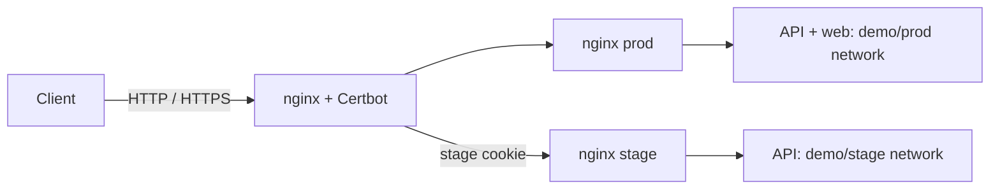

# Composer example

A runnable GitOps repository for [Composer](https://github.com/dmironenko/composer).
An outer nginx terminates TLS and routes requests to independent production and
stage nginx instances. The API runs in both environments; the web app runs only in
production. Container images are pinned by digest.

```text
apps/
  demo/
    api/                   # base.yaml, stage.yaml, message template
    web/                   # base.yaml, message template
    nginx/                 # base.yaml, stage.yaml, nginx template
  edge/
    gateway/               # nginx + Certbot
      vars/base.yaml       # TLS settings and a public demo routing token
      configs/
templates/compose.yaml.tmpl
host.yaml.example          # copy outside this repository
```

One directory is one Compose project. `prod` reads `base.yaml`; other environments
read `base.yaml` plus `stage.yaml`. Missing `stage.yaml` disables an app outside
production. Put shared settings in `base.yaml` and only differences in `stage.yaml`.

## Local quick start

Requires Git, Go 1.26.3 or newer, and Docker Engine or Docker Desktop. Clone the
repositories side by side into a new directory:

```sh
git clone --branch master https://github.com/dmironenko/composer.git
git clone --branch master https://github.com/dmironenko/composer-example.git
(cd composer && go build -o bin/composer ./cmd/composer)
cd composer-example
git branch dev master
cp host.yaml.example ../composer.local.yaml
../composer/bin/composer validate --config ../composer.local.yaml
../composer/bin/composer apply --config ../composer.local.yaml --wait --timeout 15m
```

If a local `dev` branch already exists, use it instead of creating it again. The
example has a public test token, `composer-example-test`; age, SOPS, and Python are
not needed to start it. Composer reads committed branches, so commit edits before
applying them. Host configuration paths are relative to the host YAML file.

The gateway binds only `127.0.0.1:18080` and `127.0.0.1:18443`. Before running another
copy, choose a unique `installation` and `state_dir` in host YAML and free ports in
`apps/edge/gateway/vars/base.yaml`, including `tls.https_port`. Commit those port
changes to both selected branches. Containers, networks, and named volumes are
isolated by installation and environment; published ports must still be distinct.

Networks, volumes, and a local development certificate are created automatically:

```sh
curl -ki https://localhost:18443/api/
curl -ki --cookie 'composer_stage=composer-example-test:stage' https://localhost:18443/api/
../composer/bin/composer run --config ../composer.local.yaml
```

The first request returns `X-Composer-Environment: prod`; the second selects stage.
`/api/` works in both environments. `/` returns an error in stage because no stage
web app is configured. Invalid or missing cookies select prod; an unavailable
selected environment returns an error, without falling back to prod.

Use a separate browser profile for stage: the same origin shares cookies and local
storage. The routing cookie is not application authentication. The local certificate
is for development; `curl -k` skips certificate verification only for this example.

## Change an application

Keep `composer run` running in another terminal:

```sh
git switch dev
# Edit apps/demo/api/vars/base.yaml, a config template, or a Dockerfile.
git add apps templates
git commit -m 'Update API'
# Inspect stage, then promote the change:
git switch master
git merge dev
```

The local source sees commits without a push. Remote sources require a push.
Revert a commit in the corresponding branch to roll back. Config-only changes
are applied even when an image has not changed. For source builds, set
`build.commit` in the branch's `base.yaml`, then promote it with the same merge.

The shared gateway runs only in prod and comes from `master`. Change the inner
nginx on `dev` to test application routing; shared gateway changes take effect
when merged into `master`.

## Networks and personal environments



Each environment's nginx and apps connect to their namespace network. The gateway's
`route_namespace: demo` makes the shared template attach it to the demo networks
for `.Environments`. Composer creates these networks before starting deployments.
Inner nginx instances use `nginx-<environment>` aliases and Docker DNS. Only the
gateway publishes host ports; apps can scale with `deploy.replicas`.

Create a Git branch and add it to the external host YAML:

```sh
git branch users/alice dev
```

```yaml
source:
  branches:
    prod: master
    stage: dev
    alice: users/alice
```

`composer run` loads the change on its next pass. The new environment uses its
branch's `stage.yaml` files, isolated networks, and isolated named volumes. Use
`composer_stage=composer-example-test:alice` to route requests there. Data is not
copied from production.

Adding or removing an environment can recreate the gateway to update its network
attachments, briefly interrupting ingress. Existing application containers stay
unchanged. Removing the host YAML entry removes that environment's containers;
volumes and images remain. Failed fetches or missing branches retain the deployment.

## Use your own routing secret

Before exposing this example on your server, replace the public demo token. Install
age, SOPS, and OpenSSL. Keep the private key outside the GitOps repository:

```sh
umask 077
age-keygen -o ../composer-example.agekey
export SOPS_AGE_KEY_FILE="$PWD/../composer-example.agekey"
sops encrypt --in-place --age "$(age-keygen -y "$SOPS_AGE_KEY_FILE")" \
  --encrypted-regex '^secrets$' apps/edge/gateway/vars/base.yaml
composer_token=$(openssl rand -hex 32)
printf '"%s"' "$composer_token" | sops set --value-stdin \
  apps/edge/gateway/vars/base.yaml '["secrets"]["stage_token"]'
unset composer_token
```

Add `age_key_file: composer-example.agekey` to `../composer.local.yaml`. Commit the
encrypted `base.yaml`; never commit the private key. Use
`sops apps/edge/gateway/vars/base.yaml` for later edits, including plaintext fields:
SOPS authenticates the whole file. Read your token for a cookie with:

```sh
sops decrypt --extract '["secrets"]["stage_token"]' apps/edge/gateway/vars/base.yaml
```

See the [Composer secrets guide](https://github.com/dmironenko/composer/blob/master/docs/secrets.md).

## Public TLS

The pinned [nginx-certbot image](https://github.com/JonasAlfredsson/docker-nginx-certbot)
handles certificate issuance, renewal, and nginx reload. No custom TLS maintenance
script or Docker socket mount is needed.

Update `apps/edge/gateway/vars/base.yaml` through SOPS if encrypted:

- `tls.domain`: your domain; `tls.https_port: 443`.
- `compose.services.nginx.environment.CERTBOT_EMAIL`: your email.
- `compose.services.nginx.environment.USE_LOCAL_CA: "0"`.
- `compose.services.nginx.ports`: `["80:80", "443:443"]`.

Point DNS to your server and make port 80 reachable for HTTP-01. The gateway uses
`/etc/letsencrypt/live/site/fullchain.pem` and `privkey.pem`. Certificates persist
in a named volume. When switching from the local CA to public ACME, choose a new
empty certificate volume; do not reuse the local-CA certificates.

On Ubuntu, install the agent with
[composer install](https://github.com/dmironenko/composer/blob/master/docs/systemd.md).

## Contributing

Use two-space YAML indentation, single-line `command` and `healthcheck.test` strings,
and a blank line before `compose` and `secrets`. Shell commands must explicitly use
`sh -c`. Keep the checked-in example runnable with public demo values.

Open a pull request with a focused change and describe how you validated it.
Validate changes before applying them:

```sh
../composer/bin/composer validate --config ../composer.local.yaml
```

Commit changes first: Composer reads committed snapshots. Try deployments in a
separate installation with its own state directory and free ports.
