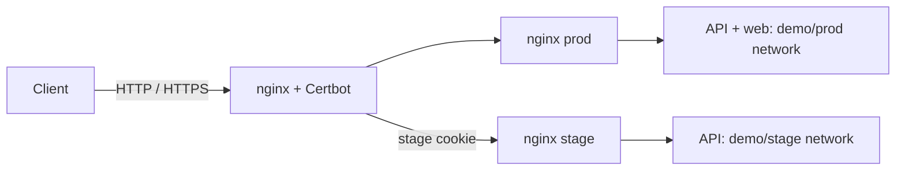

# Composer example

A GitOps example for [Composer](https://github.com/dmironenko/composer).
The ingress nginx handles TLS with Certbot and routes requests to prod or stage.
The API runs in both environments; the web app runs only in prod. Images are pinned
by digest.

```text
apps/
  demo/
    api/                   # base.yaml, stage.yaml, message template
    web/                   # base.yaml, message template
    nginx/                 # base.yaml, stage.yaml, nginx template
  ingress/
    nginx/                 # nginx + Certbot
      vars/base.yaml       # TLS settings and an encrypted demo routing token
      configs/
templates/compose.yaml.tmpl
host.yaml.example          # copy outside this repository
demo.agekey                # public demo identity; never use for real secrets
```

`prod` reads `base.yaml`; other environments add `stage.yaml` overrides.
Missing `stage.yaml` disables an app outside prod. Keep app-specific settings
under `app`, Compose settings under `compose`, and encrypted values under `secrets`.

## Local quick start

Requires Git, Go 1.26.3 or newer, and Docker Engine or Docker Desktop. Clone the
repositories side by side into a new directory:

```sh
git clone --branch master https://github.com/dmironenko/composer.git
git clone --branch master https://github.com/dmironenko/composer-example.git
(cd composer && go build -o bin/composer ./cmd/composer)
cd composer-example
git branch dev master
cp host.yaml.example ../composer.local.yaml
install -m 600 demo.agekey ../composer-example.agekey
../composer/bin/composer validate --config ../composer.local.yaml
../composer/bin/composer apply --config ../composer.local.yaml --wait --timeout 15m
```

Skip `git branch dev master` if `dev` already exists. Host configuration paths
are relative to the host YAML file. Composer reads committed snapshots.
The demo key and token are public; encryption here demonstrates the Composer secrets workflow.

The ingress binds `127.0.0.1:18080` and `127.0.0.1:18443`. For another copy, use a
unique `installation` and `state_dir`, and choose free ports in
`apps/ingress/nginx/vars/base.yaml`, including `app.tls.https_port`. Commit port changes
to both branches. The ordinary YAML fields can be edited directly.

Composer creates networks and volumes; nginx-certbot creates a local certificate.
Check both environments, then start polling:

```sh
curl -ki https://localhost:18443/api/
curl -ki --cookie 'composer_stage=composer-example-test:stage' https://localhost:18443/api/
../composer/bin/composer run --config ../composer.local.yaml
```

The first request returns `X-Composer-Environment: prod`; the second selects stage.
`/api/` works in both; `/` fails in stage because it has no web app. Invalid or
missing cookies select prod. An unavailable selected environment returns an error.

Use a separate browser profile for stage to avoid sharing cookies and local storage.
The cookie selects traffic; it does not authenticate users. `curl -k` skips
verification of the local development certificate.

## Change an application

Keep `composer run` running in another terminal:

```sh
git switch dev
# Edit apps/demo/api/vars/base.yaml, a config template, or a Dockerfile.
git add apps templates
git commit -m 'Update API'
# Inspect stage, then promote the change:
git switch master
git merge dev
```

Local sources see commits without a push; remote sources need one. Config-only
changes also trigger deployment. Revert a commit to roll back. For source builds,
change `build.commit` in `base.yaml` and promote it with the same merge.

The shared ingress runs only from `master`. Test inner nginx routing on `dev`.

## Networks and personal environments



Each environment has its own demo network. `app.route_namespace: demo` connects the
ingress to these networks. Only the ingress publishes ports; apps can scale with
`deploy.replicas`.

Create a Git branch and add it to the external host YAML:

```sh
git branch users/alice dev
```

```yaml
source:
  branches:
    prod: master
    stage: dev
    alice: users/alice
```

`composer run` picks up the entry on its next pass. Use
`composer_stage=composer-example-test:alice` to select it. The environment uses its
branch's `stage.yaml` overrides and separate networks and volumes; prod data is
not copied.

Adding or removing an environment can briefly interrupt ingress while its network
attachments update. Removing the entry removes that environment's containers but
keeps volumes and images. Failed fetches or missing branches preserve deployments.

## Secrets

The `secrets.stage_token` value at the bottom of `apps/ingress/nginx/vars/base.yaml`
is encrypted with age. Field names and nesting remain visible. Composer reads
the shared key from `age_key_file` and exposes the decrypted value to templates
as `.Secrets.stage_token`.

Encrypt one value and paste the output after `stage_token:`:

```sh
printf '%s' 'composer-example-test' | ../composer/bin/composer secrets encrypt --key-file ../composer-example.agekey
```

More secrets can be added independently:

```yaml
secrets:
  stage_token: ENC[...]
  database:
    password: ENC[...]
```

To read a value, run this command, paste only its `ENC[…]` string, and finish with Ctrl-D:

```sh
../composer/bin/composer secrets decrypt --key-file ../composer-example.agekey
```

Before using the stack on a server, generate your own key outside Git:

```sh
age-keygen -o ../composer-private.agekey
chmod 600 ../composer-private.agekey
```

Encrypt a new token with that key and set `age_key_file: composer-private.agekey`
in the external host YAML. All apps can use the same key; they need no additional
key settings. Commit encrypted values only.
See the [Composer secrets guide](https://github.com/dmironenko/composer/blob/master/docs/secrets.md).

## Public TLS

The pinned [nginx-certbot image](https://github.com/JonasAlfredsson/docker-nginx-certbot)
issues and renews certificates and reloads nginx.

Update `apps/ingress/nginx/vars/base.yaml`:

- `app.tls.domain`: your domain; `app.tls.https_port: 443`.
- `compose.services.nginx.environment.CERTBOT_EMAIL`: your email.
- `compose.services.nginx.environment.USE_LOCAL_CA: "0"`.
- `compose.services.nginx.ports`: `["80:80", "443:443"]`.

Point DNS to your server and open port 80 for HTTP-01. Certificates persist in a
named volume. Use a new empty certificate volume when switching from the local CA
to public ACME.

On Ubuntu, install the agent with
[composer install](https://github.com/dmironenko/composer/blob/master/docs/systemd.md).

## Contributing

Use two-space YAML indentation, single-line `command` and `healthcheck.test` strings,
and a blank line before `compose` and `secrets`. Shell commands must explicitly use
`sh -c`. Keep the checked-in example runnable with public demo values.

Commit changes, then validate:

```sh
../composer/bin/composer validate --config ../composer.local.yaml
```

Test deployments in a separate installation with its own state directory and free
ports. Describe your checks in the pull request.
